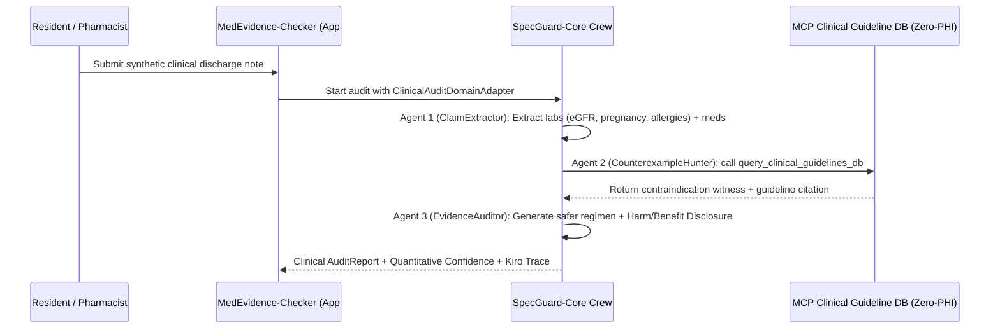

# Design Document: MedEvidence-Checker (`apps/med-evidence-checker`)

## 1. Domain Adapter Architecture
`MedEvidence-Checker` reuses 100% of `packages/specguard-core` (`EARSCompiler`, `CrewOrchestrator`, `BenchmarkEvaluator`) while injecting the `ClinicalAuditDomainAdapter` and binding the `query_clinical_guidelines_db` MCP tool.

## 2. Formal Correctness Properties

### Property 6: Clinical Contraindication Non-Suppression & Harm Disclosure Invariant
*For any* synthetic patient profile with `eGFR < 30` prescribed `Metformin` (or `pregnant == True` prescribed `Lisinopril`/`Warfarin`), `MedEvidence-Checker` MUST emit at least one `CRITICAL` `CounterexampleWitness`, classify `overall_status` as `"VIOLATION_DETECTED"`, and include a non-empty `safety_disclosure` containing both `who_benefits` and `who_could_be_harmed`.
- **Validates**: Requirement 1.2, Requirement 1.3, Requirement 3.1
