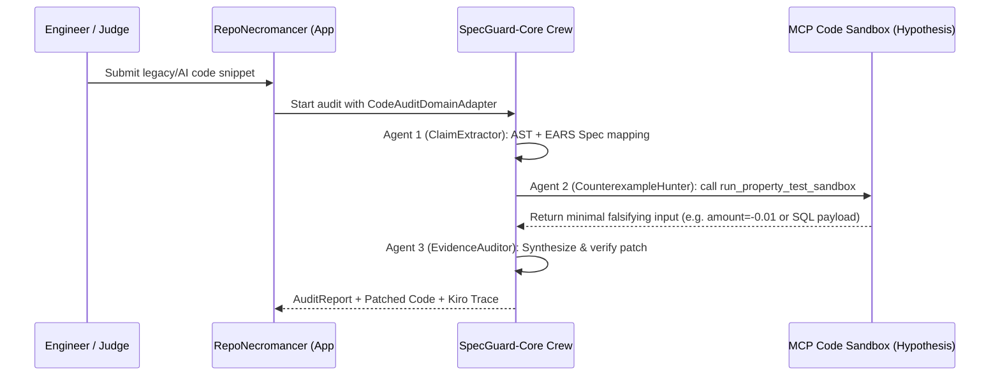

# Design Document: RepoNecromancer (`apps/repo-necromancer`)

## 1. Domain Adapter Architecture
`RepoNecromancer` plugs into `packages/specguard-core` by implementing the `CodeAuditDomainAdapter` and binding the `run_property_test_sandbox` MCP tool from `packages/specguard-mcp-server`.

## 2. Formal Correctness Properties

### Property 5: Counterexample Reproducibility & Patch Soundness
*For any* buggy code sample in the `RepoNecromancer` benchmark where `run_property_test_sandbox` reports a falsifying `witness_input`, executing the original function on `witness_input` MUST trigger the violation, and executing the synthesized patched function on `witness_input` MUST satisfy the EARS postcondition without raising an unhandled exception.
- **Validates**: Requirement 2.2, Requirement 3.1
