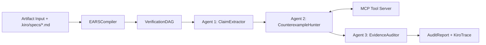

# Design Document: SpecGuard-Core Verification Skeleton

## 1. Architecture Overview
`packages/specguard-core` provides the reusable foundation for **SpecGuard-Crew**. It contains zero hardcoded references to either software ASTs or clinical pharmacology—instead, domain specifics are injected through a clean `DomainAdapter` protocol and MCP tool bindings.

## 2. Core Data Models (`packages/specguard-core/models.py`)
- `EARSClause`: `clause_id: str`, `keyword: Literal["WHEN", "IF", "WHILE", "WHERE"]`, `condition: str`, `system_actor: str`, `obligation: str`.
- `AtomicClaim`: `claim_id: str`, `source_span: str`, `statement: str`, `category: str`, `mapped_clause_id: Optional[str]`.
- `CounterexampleWitness`: `claim_id: str`, `violated: bool`, `severity: Literal["CRITICAL", "WARNING", "INFO", "SAFE"]`, `witness_input: str`, `observed_outcome: str`, `mcp_tool_used: str`, `evidence_citation: str`.
- `AuditReport`: `artifact_id: str`, `domain: str`, `overall_status: Literal["VIOLATION_DETECTED", "WARNING_ONLY", "VERIFIED_SAFE"]`, `claims: List[AtomicClaim]`, `witnesses: List[CounterexampleWitness]`, `remediation: str`, `kiro_trace: List[AgentTraceStep]`, `safety_disclosure: Optional[Dict[str, Any]]`.

---

## 3. Formal Correctness Properties (For `Hypothesis` Property-Based Testing)

### Property 1: EARS Compilation Idempotence & Round-Trip Determinism
*For any* valid EARS clause containing `WHEN/IF/WHILE/WHERE <condition> THE <actor> SHALL <obligation>`, compiling the formatted clause string with `EARSCompiler.compile_text()` shall extract the exact condition and obligation, and re-compiling the rendered EARS markdown shall produce an identical `VerificationDAG`.
- **Validates**: Requirement 1.1, Requirement 1.3

### Property 2: Monotonic Severity Escalation in Evidence Auditor
*For any* non-empty list of `CounterexampleWitness` results produced by `CounterexampleHunter`, if at least one witness has `violated == True` and `severity == "CRITICAL"`, then `EvidenceAuditor.aggregate_status()` MUST return `"VIOLATION_DETECTED"`; conversely, `"VERIFIED_SAFE"` may only be returned when zero witnesses have `violated == True`.
- **Validates**: Requirement 2.3

### Property 3: 3-Agent Trace Completeness Invariant
*For any* verification run completed by `CrewOrchestrator`, the resulting `AuditReport.kiro_trace` list MUST contain exactly 3 ordered trace steps (`["ClaimExtractor", "CounterexampleHunter", "EvidenceAuditor"]`) with non-negative `duration_ms` and valid references to `.kiro/` artifacts.
- **Validates**: Requirement 2.1

### Property 4: Confusion Matrix Metric Bounds & Zero-Division Safety
*For any* non-negative integers `tp, fp, tn, fn` (including `0, 0, 0, 0`), `BenchmarkEvaluator.compute_metrics(tp, fp, tn, fn)` MUST return `precision`, `recall`, `specificity`, `f1_score`, and `false_negative_rate` strictly within `[0.0, 1.0]` and satisfy `tp + fp + tn + fn == total`.
- **Validates**: Requirement 3.1, Requirement 3.2
