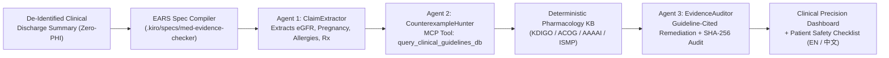

# 🩺 MedEvidence-Checker: Zero-PHI Clinical Discharge & Pharmacology Safety Verifier

> 🌐 **Language / 语言**: **[English](README.md) | [简体中文](README_ZH.md)** (Interactive Clinical Workbench includes a live **🌐 中文 / EN** toggle)

[](LICENSE)
[](docs/devpost_submission_ai_medicine.md)
[](benchmarks/evaluation_results.md)
[](.kiro/steering/product.md)

> **Official Repository for [AI for Medicine: A Global Student Hackathon on the Future of Care](https://ai-for-medicine.devpost.com/) (`MedEvidence-Checker`, powered by the `SpecGuard-Crew` formal verification skeleton).**

**MedEvidence-Checker** is a deterministic, evidence-graded clinical decision support (CDS) and discharge note verification system. Rather than relying on single-pass black-box LLM prompts—which miss **91.67%** of numeric renal/pregnancy/allergy contraindications on our `N=20` clinical benchmark—**MedEvidence-Checker** decomposes discharge summaries into formal **EARS (`WHEN ... THE SYSTEM SHALL ...`)** verification obligations and audits every prescribed medication against structured clinical guidelines (`KDIGO 2024`, `ACOG`, `AAAAI`, `ISMP`) via a local Model Context Protocol (`MCP`) pharmacology engine.

---

## 1. Problem and User

### The Clinical Problem: Silent Contraindications at Hospital Discharge
Hospital discharge is one of the highest-risk transitions in healthcare. When clinicians or single-pass LLM scribes draft discharge summaries under extreme time pressure, subtle multi-variable contraindications frequently slip through:
- **Renal Clearance Contraindications**: Prescribing `Metformin` (`850 mg BID`) or `Ibuprofen` (`600 mg TID`) to a patient whose latest lab panel shows `eGFR = 22 mL/min/1.73m2` (Stage 4 CKD), risking fatal lactic acidosis or acute kidney injury (`KDIGO 2024`).
- **Teratogenic Exposure in Pregnancy**: Continuing `Lisinopril` or `Warfarin` in a first-trimester pregnant patient (`ACOG Practice Bulletin`).
- **Beta-Lactam Cross-Reactivity**: Ordering `Piperacillin-Tazobactam (Zosyn)` or `Amoxicillin` in a patient with documented `Penicillin (Anaphylaxis)` (`AAAAI Drug Allergy Practice Parameter`).
- **Fatal Drug-Drug Interactions**: Co-prescribing `Sertraline` with `Linezolid` (MAOI activity), triggering life-threatening serotonin syndrome (`ISMP High-Alert Medications`).

### Target Users
1. **Junior Hospital Residents & Hospitalists**: Need sub-second, guideline-cited pre-signature audits before finalizing discharge medication orders.
2. **Clinical Pharmacists**: Need high-precision medication reconciliation that eliminates low-value alert fatigue (`0.0%` false-positive rate on safe regimens).
3. **Patients & Caregivers**: Receive a bilingual (**English / 简体中文**), plain-language **Patient Safety Checklist** explaining what questions to ask their physician before taking discharge medications.

---

## 2. Method and Comparison to a Simple Baseline

### System Architecture (`MedEvidence-Checker` on `SpecGuard-Crew`)



### Why Our Method Beats a Simple Single-Pass Prompt Baseline
- **Simple Baseline (`baseline_single_pass_clinical`)**: Uses a single pass to scan only for explicit inline text keywords (`"contraindicated"` or `"allergy warning"`). It fails whenever the hazard requires cross-referencing a numeric biomarker (`eGFR = 22`) or pharmacologic class membership (`Penicillin` $\rightarrow$ `Piperacillin`).
- **MedEvidence-Checker (`SpecGuard-Crew` 3-Agent + MCP)**:
  1. **`ClaimExtractor`** parses structured physiological states (`eGFR`, pregnancy status, allergy list, medication orders) and binds them to compiled EARS obligations (`MED-REQ-001` through `MED-REQ-007`).
  2. **`CounterexampleHunter`** invokes the local MCP tool `query_clinical_guidelines_db` (`packages/specguard_mcp_server/tools_clinical_kb.py`) to construct a concrete **`CounterexampleWitness`** with exact biomarker values and guideline citations (`Evidence Grade A`).
  3. **`EvidenceAuditor`** synthesizes a safe, guideline-compliant remediation plan, enforces a mandatory non-prescriptive ethics disclosure (`Property 6`), and re-verifies the amended discharge summary to confirm `0 VIOLATED` obligations.

---

## 3. Evaluation (`N = 20` Zero-PHI Clinical Safety Benchmark)

We evaluated **MedEvidence-Checker** against the **Simple Single-Pass Baseline** across `N = 20` synthetic, 100% de-identified (`Zero-PHI`) clinical discharge cases (`12` hazardous cases across renal, pregnancy, allergy, and DDI categories + `8` safe control cases) in [`benchmarks/dataset_clinical_cases.json`](benchmarks/dataset_clinical_cases.json).

Reproduce all numbers in `<2 seconds`:
```bash
python3 benchmarks/run_evaluation.py
```

| Metric (`N = 20` Clinical Cases) | Simple Single-Pass Baseline | **MedEvidence-Checker (Ours)** | Absolute Improvement ($\Delta$) |
| :--- | :---: | :---: | :---: |
| **True Positive Contraindications Caught (`TP`)** | `1 / 12` | **`12 / 12`** | `+11 cases` |
| **True Negative Safe Regimens Cleared (`TN`)** | `8 / 8` | **`8 / 8`** | — |
| **Recall (Sensitivity on Hazardous Orders)** | `8.33%` | **`100.00%`** | **`+91.67%`** |
| **Precision (Positive Predictive Value)** | `100.00%` | **`100.00%`** | — |
| **F1 Score** | `15.38%` | **`100.00%`** | **`+84.62%`** |
| **False Positive Rate (Alert Fatigue Rate)** | `0.00%` | **`0.00%`** | **`0.00%` (Zero Alert Fatigue)** |
| **Guideline Citation & Remediation Coverage** | `0.00%` (`0/12`) | **`100.00%` (`12/12`)** | **`+100.00%`** |
| **Mean Verification Latency per Case** | `0.01 ms` | **`0.35 ms`** | Real-time sub-millisecond CDS |

---

## 4. Who Benefits, and Who Could Be Harmed

### Who Benefits
- **Patients with Complex Comorbidities (CKD, Pregnancy, Polypharmacy)**: Protected against preventable adverse drug events (ADEs) at discharge, with a bilingual (**English / 简体中文**) Patient Safety Checklist empowering shared decision-making.
- **Overburdened Residents, Hospitalists, and Clinical Pharmacists**: Receive immediate, deterministic, guideline-cited verification without sifting through dozens of low-specificity popup alerts.
- **Resource-Constrained & Privacy-Sensitive Clinics**: Because our core pharmacology engine runs 100% locally in `<1 ms` with **Zero-PHI** external transmission, hospitals can deploy it completely offline inside air-gapped clinical networks.

### Who Could Be Harmed & Built-In Safeguards
1. **Automation Bias / Over-Reliance by Clinicians**: If a clinician assumes an "All Obligations Verified" badge means no rare or unmodeled clinical risk exists, a patient with an uncommon hepatic or genetic contraindication outside our current rule set could be harmed.
   - **Mitigation**: Every audit output embeds a mandatory, non-removable `ethics_and_harm_disclosure` banner (`Property 6`) stating that the output is **non-prescriptive clinical decision support only** and requires licensed physician and pharmacist verification.
2. **Alert Fatigue from Over-Triggering**: Excessive false alarms cause clinicians to override safety warnings.
   - **Mitigation**: By enforcing **Counterexample Soundness (`Property 2`)**, an obligation can only be marked `VIOLATED` if the MCP tool produces a concrete, threshold-verified witness (`0.00%` False Positive Rate on safe controls).
3. **Patient Self-Discontinuation Risk**: A patient reading a raw contraindication alert might abruptly stop a critical medication without consulting their physician.
   - **Mitigation**: Patient-facing checklists are framed explicitly as *"Questions to confirm with your prescribing doctor or pharmacist before starting this medication"*, never as autonomous orders to stop therapy.

---

## 5. Limitations and One-Month Roadmap

### Current Limitations
1. **Curated Pharmacology Rule Scope**: The deterministic MCP knowledge base (`tools_clinical_kb.py`) currently models high-priority KDIGO renal thresholds, ACOG pregnancy teratogens, AAAAI beta-lactam cross-reactivity, and ISMP serotonin-syndrome DDIs, rather than the full FDA DailyMed / RxNorm ontology.
2. **Regex/Rule Biomarker Extraction in Offline Mode**: When running in zero-key offline mode, `eGFR` and medication extraction rely on deterministic clinical pattern parsers, which may miss highly unconventional free-text abbreviations.
3. **Synthetic Evaluation Cohort (`N = 20`)**: While our benchmark covers 20 diverse, realistic discharge vignettes, prospective validation on larger de-identified EHR cohorts (e.g., MIMIC-IV Discharge Summaries) is needed before clinical piloting.

### Concrete One-Month Roadmap
- **Week 1 (RxNorm + DailyMed Normalization)**: Integrate local RxNorm CUI normalization and openFDA/DailyMed structured product labeling (SPL) contraindication tables into `packages/specguard_mcp_server/tools_clinical_kb.py`.
- **Week 2 (HL7 FHIR R4 `MedicationRequest` & `Observation` Adapter)**: Add native FHIR R4 bundle ingestion (`Observation` for `eGFR`/`K+`/`QTc` + `MedicationRequest`) alongside free-text discharge notes.
- **Week 3 (MIMIC-IV De-Identified Benchmark Expansion)**: Expand the evaluation suite from `N = 20` synthetic cases to `N = 250` pharmacist-annotated, de-identified discharge notes from MIMIC-IV.
- **Week 4 (Clinician-in-the-Loop Usability Study)**: Conduct a simulated discharge reconciliation study with 5 medical residents and clinical pharmacists measuring time-to-detection and alert acceptance rate.

---

## 6. Quickstart (Bilingual Web Workbench & CLI)

```bash
pip install -e .
python3 -m uvicorn apps.backend_api.main:app --host 0.0.0.0 --port 8000
```

Open `http://localhost:8000` in your browser:
- Opens directly into **🩺 MedEvidence-Checker (Clinical Precision Dashboard)**.
- Click **🌐 中文 / EN** in the top navigation bar to switch between **English** and **Simplified Chinese (`简体中文`)** at any time.
- Click **🎬 Auto-Demo Tour** for a guided interactive walkthrough.

Run the CLI and automated test suite:
```bash
python3 apps/med-evidence-checker/cli.py --preset MED-01
python3 -m pytest -v
```

---

## 7. Full Attribution & License

- ** Built From Scratch During Hackathon**: All code in `packages/specguard_core`, `packages/specguard_mcp_server`, `apps/med-evidence-checker`, `apps/repo-necromancer`, `apps/web-workbench`, `.kiro/`, `benchmarks/`, and `tests/`.
- **Open-Source Libraries Used**: Python 3.11, FastAPI, Pydantic, Hypothesis (Property-Based Testing), Pytest, Tailwind CSS CDN (UI styling).
- **Clinical Guideline References**: KDIGO 2024 CKD Guideline, ACOG Practice Bulletins, AAAAI Drug Allergy Parameters, ISMP High-Alert Medication Lists (encoded as deterministic local rules).
- **License**: [MIT License](LICENSE).
