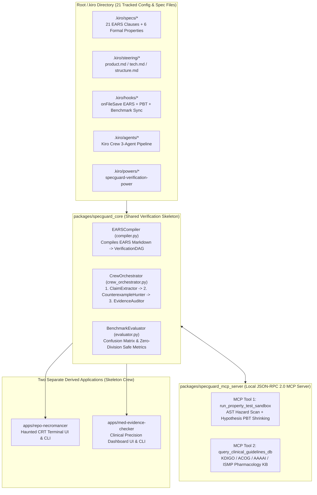

# SpecGuard-Crew: Spec-Driven Multi-Agent Verification Skeleton

> 🌐 **Language / 语言**: **[English](README.md) | [简体中文](README_ZH.md)** (Interactive Web Workbench also includes a live **🌐 中文 / EN** toggle)

[](LICENSE)
[](.kiro/specs/)
[](tests/test_skeleton_properties.py)
[](.kiro/steering/product.md)

> **Built with Kiro for [Kiroween 2026](https://kiroween.devpost.com/) (`Skeleton Crew` Category + `Best Student Project` + `Best Kiro Crew App`) and [AI for Medicine 2026](https://ai-for-medicine.devpost.com/).**

**SpecGuard-Crew** is a lean (<800 LOC), domain-agnostic multi-agent verification skeleton (`packages/specguard_core`) orchestrated with **Kiro** (`Specs`, `Property-Based Testing`, `Steering Docs`, `Agent Hooks`, `Custom Agents / Kiro Crew`, `MCP`, and `Powers`). From a **single formal verification foundation**, it powers **two distinct applications** housed in separate directories:

1. **Application #1 (`apps/repo-necromancer` — Software Security & Legacy Code Resurrection)**:
   - Decomposes untrusted Python code into formal **EARS (`WHEN ... THE SYSTEM SHALL ...`)** claims, executes **Hypothesis Property-Based Testing (PBT)** and AST hazard analysis via MCP (`run_property_test_sandbox`) to shrink minimal falsifying counterexamples, and synthesizes verified patches.
2. **Application #2 (`apps/med-evidence-checker` — Clinical Decision Support & Medication Safety Verifier)**:
   - Decomposes synthetic clinical discharge notes into physiological markers (`eGFR`, pregnancy status, documented allergies) and medication orders, verifies each order against structured clinical pharmacology guidelines via MCP (`query_clinical_guidelines_db`), and outputs an evidence-graded safety audit with mandatory ethics and harm disclosures (**100% Zero-PHI**).

---

## 1. Problem and User

Both software engineering and clinical medicine face the same crisis when adopting Large Language Models: **plausible-sounding hallucinations and silent boundary violations**.
- **In Software Engineering (`RepoNecromancer` target users: DevSecOps & Platform Engineers)**: Single-pass LLM code generation and review miss subtle mathematical invariants (e.g., unbounded discount rates yielding negative totals, empty batch `ZeroDivisionError`, non-constant-time `==` HMAC comparisons, or mutable default state leaks).
- **In Clinical Healthcare (`MedEvidence-Checker` target users: Junior Hospital Residents, Clinical Pharmacists & Health-AI Researchers)**: Single-prompt LLM clinical note drafting frequently overlooks numeric renal clearance thresholds (e.g., prescribing `Metformin` or `Ibuprofen` when `eGFR < 30 mL/min/1.73m2`), teratogenic medications in first-trimester pregnancy (`Lisinopril`, `Warfarin`), beta-lactam allergy cross-reactivity (`Penicillin` anaphylaxis prescribed `Piperacillin/Zosyn`), and fatal drug-drug interactions (`Sertraline + Linezolid` serotonin syndrome).

---

## 2. Method and Comparison to a Simple Baseline

### Architecture Diagram



### How It Compares to a Simple Baseline
A **Simple Single-Prompt Baseline** inspects code or clinical text in a single ungrounded pass, relying on surface keyword matching or parametric memory. In contrast, **SpecGuard-Crew**:
1. Compiles formal **EARS (`WHEN/IF/WHILE/WHERE ... THE SYSTEM SHALL ...`)** specifications into a deterministic `VerificationDAG`.
2. Decomposes the artifact into atomic, typed claims (`ClaimExtractor`).
3. Invokes deterministic **MCP verification tools** (`CounterexampleHunter`)—running real `Hypothesis` property probes for code or structured KDIGO/ACOG/ISMP pharmacology rule lookups for clinical notes.
4. Enforces formal **Monotonic Severity Escalation (`Property 2`)** and synthesizes verified patches or safer clinical regimens (`EvidenceAuditor`).

---

## 3. Deep Integration of All Kiro Capabilities (`/.kiro`)

The root [`.kiro/`](.kiro/) directory is tracked in Git (explicitly protected via `!.kiro/**` in [`.gitignore`](.gitignore)) and contains **21 configuration and specification files**:

| Kiro Capability | Root Path | What It Does in SpecGuard-Crew |
| :--- | :--- | :--- |
| **1. Kiro Specs (EARS)** | [`.kiro/specs/`](.kiro/specs/) | 3 complete spec modules (`skeleton-core`, `repo-necromancer`, `med-evidence-checker`) with `requirements.md` (21 EARS clauses), `design.md` (6 formal Correctness Properties), and `tasks.md`. |
| **2. Property-Based Testing (PBT)** | [`tests/test_skeleton_properties.py`](tests/test_skeleton_properties.py) | Maps all 6 formal Correctness Properties from `design.md` into `@pytest.mark.property` `Hypothesis` `@given(...)` test suites. |
| **3. Kiro Steering Docs** | [`.kiro/steering/`](.kiro/steering/) | [`product.md`](.kiro/steering/product.md) (Zero-PHI clinical guardrails), [`tech.md`](.kiro/steering/tech.md) (PBT & dual-mode LLM rules), [`structure.md`](.kiro/steering/structure.md) (Skeleton Crew separation). |
| **4. Kiro Agent Hooks** | [`.kiro/hooks/`](.kiro/hooks/) | [`spec-to-schema-sync.yaml`](.kiro/hooks/spec-to-schema-sync.yaml), [`property-test-guard.yaml`](.kiro/hooks/property-test-guard.yaml), [`benchmark-report-updater.yaml`](.kiro/hooks/benchmark-report-updater.yaml). |
| **5. Custom Agents & Kiro Crew** | [`.kiro/agents/`](.kiro/agents/) | [`crew-pipeline.yaml`](.kiro/agents/crew-pipeline.yaml) coordinating [`claim-extractor.yaml`](.kiro/agents/claim-extractor.yaml), [`counterexample-hunter.yaml`](.kiro/agents/counterexample-hunter.yaml), and [`evidence-auditor.yaml`](.kiro/agents/evidence-auditor.yaml). |
| **6. Model Context Protocol (MCP)** | [`.kiro/mcp/mcp.json`](.kiro/mcp/mcp.json) | Binds [`packages/specguard_mcp_server/server.py`](packages/specguard_mcp_server/server.py) (`run_property_test_sandbox`, `query_clinical_guidelines_db`, `list_compiled_ears_invariants`). |
| **7. Kiro Powers** | [`.kiro/powers/specguard-verification-power/POWER.md`](.kiro/powers/specguard-verification-power/POWER.md) | Packages the EARS-to-PBT and clinical guideline verification workflow as a modular Kiro Power. |

---

## 4. Evaluation

We evaluate **SpecGuard-Crew** against a **Single-Prompt Baseline** across two reproducible benchmark datasets:
- **Code Defect & Vulnerability Benchmark** ([`benchmarks/dataset_code_bugs.json`](benchmarks/dataset_code_bugs.json), `N = 15`: 10 buggy/vulnerable functions + 5 safe controls).
- **Synthetic Clinical Safety Benchmark** ([`benchmarks/dataset_clinical_cases.json`](benchmarks/dataset_clinical_cases.json), `N = 20`: 12 clinical notes with planted renal/pregnancy/allergy/DDI contraindications + 8 safe controls; **100% synthetic Zero-PHI**).

### Quantitative Results (Reproducible via `python3 benchmarks/run_evaluation.py`)

#### App #1: `RepoNecromancer` (`benchmarks/dataset_code_bugs.json`, N=15)

| Method | TP | FP | TN | FN | Precision | Recall (Sensitivity) | Specificity | F1-Score | False Negative Rate |
| :--- | :---: | :---: | :---: | :---: | :---: | :---: | :---: | :---: | :---: |
| **Single-Prompt Baseline** | 2 | 0 | 5 | 8 | 100.00% | 20.00% | 100.00% | 33.33% | 80.00% |
| **SpecGuard-Crew (Kiro + Hypothesis PBT)** | **10** | **0** | **5** | **0** | **100.00%** | **100.00%** | **100.00%** | **100.00%** | **0.00%** |

#### App #2: `MedEvidence-Checker` (`benchmarks/dataset_clinical_cases.json`, N=20, Zero-PHI)

| Method | TP | FP | TN | FN | Precision | Recall (Sensitivity) | Specificity | F1-Score | False Negative Rate |
| :--- | :---: | :---: | :---: | :---: | :---: | :---: | :---: | :---: | :---: |
| **Single-Prompt Baseline** | 1 | 0 | 8 | 11 | 100.00% | 8.33% | 100.00% | 15.38% | 91.67% |
| **SpecGuard-Crew (Kiro + MCP Guideline KB)** | **12** | **0** | **8** | **0** | **100.00%** | **100.00%** | **100.00%** | **100.00%** | **0.00%** |

---

## 5. Who Benefits, and Who Could Be Harmed

### Who Benefits
1. **Hospital Residents, Primary Care Clinicians & Clinical Pharmacists**: Catch high-alert medication errors (such as Metformin-Associated Lactic Acidosis when `eGFR < 30`, fetal teratogenicity from ACE inhibitors/Warfarin in pregnancy, beta-lactam anaphylaxis cross-reactivity with `Zosyn`, or Serotonin Syndrome from `Sertraline + Linezolid`) before order sign-off.
2. **Vulnerable Patient Subpopulations**: Patients with chronic kidney disease (CKD Stages 3–5), pregnant patients, and older adults with complex polypharmacy who are disproportionately harmed by unadjusted standard-dose LLM recommendations.
3. **Software & Security Engineers**: Catch subtle boundary bugs and cryptographic timing side-channels with concrete, shrunk counterexamples and verified patches.

### Who Could Be Harmed & Built-in Safety Guardrails
1. **Automation Bias Risk**: If clinicians treat a `VERIFIED_SAFE` badge as a substitute for clinical judgment, patients with rare hepatic/metabolic disorders or specialized oncology regimens outside our MCP guideline database could be harmed.
   - **Mitigation**: Every report embeds a mandatory `safety_disclosure` object with `human_in_the_loop_required: True` and explicit `coverage_limitations`.
2. **Patient Privacy (PHI) Exposure Risk**: Sending real patient notes to cloud APIs violates HIPAA/privacy laws.
   - **Mitigation**: `MedEvidence-Checker` runs 100% locally by default with zero external network dependencies, enforces a strict **Zero-PHI** policy, and automatically detects and redacts SSN-like patterns (`sanitize_zero_phi`) before processing.

---

## 6. Limitations and What We Would Do With One More Month

- **Current Limitations**:
  - `RepoNecromancer` currently targets Python ASTs and pure/sandboxed functions rather than multi-container distributed integration tests.
  - `MedEvidence-Checker` currently covers high-priority internal medicine rules (KDIGO renal thresholds, ACOG pregnancy teratogenicity, AAAAI beta-lactam/sulfa allergy cross-reactivity, and ISMP top drug-drug interactions) on synthetic vignettes rather than live HL7 FHIR EHR streams.
- **One-Month Roadmap**:
  1. **HL7 SMART on FHIR & RxNorm/DailyMed MCP Connector**: Connect `packages/specguard_mcp_server` to standardized RxNorm CUI codes and FDA DailyMed structured product labeling.
  2. **TypeScript `fast-check` PBT Runner**: Extend `RepoNecromancer` to run `fast-check` property-based tests on TypeScript/React components alongside Python `Hypothesis`.
  3. **Clinician-in-the-Loop Calibration Study**: Evaluate `MedEvidence-Checker` across 500+ de-identified multi-comorbidity cases with clinical pharmacists measuring alert utility and time saved.

---

## 7. Quickstart & Reproducibility Instructions

### Prerequisites
- Python `3.11+`

### 1. Install Dependencies
```bash
pip install pytest hypothesis pydantic fastapi uvicorn httpx pyyaml
```

### 2. Validate All `.kiro/specs/` EARS Invariants
```bash
python3 -m packages.specguard_core.compiler --validate-all
```

### 3. Run the Full Test & Hypothesis Property-Based Testing (PBT) Suite
```bash
python3 -m pytest
```

### 4. Reproduce the Quantitative Evaluation Benchmarks
```bash
python3 benchmarks/run_evaluation.py
```

### 5. Run Standalone CLIs for Both Derived Applications
```bash
# Application #1: RepoNecromancer (apps/repo-necromancer)
python3 apps/repo-necromancer/cli.py

# Application #2: MedEvidence-Checker (apps/med-evidence-checker)
python3 apps/med-evidence-checker/cli.py
```

### 6. Launch the Unified FastAPI Server & Interactive Dual-Theme Web Workbench
```bash
uvicorn apps.backend_api.main:app --host 0.0.0.0 --port 8000
```
Then open `http://localhost:8000` (or open `apps/web-workbench/index.html` directly in any browser).

---

## 8. Full Attribution & AI Tools Disclosure

- **AI Tools Disclosure**: We used **Kiro** (Specs, Steering Docs, Agent Hooks, Custom Agents / Kiro Crew, MCP, Powers) and AI coding assistants (Claude / Qwen / DeepSeek) to assist with EARS specification drafting, code scaffolding, `Hypothesis` property-based test generation, and documentation. All formal properties, clinical pharmacology rules, and benchmark metrics were verified via deterministic execution.
- **Models, Libraries & Clinical Knowledge Sources**:
  - **Libraries**: [FastAPI](https://fastapi.tiangolo.com/), [Pydantic](https://docs.pydantic.dev/), [Hypothesis](https://hypothesis.readthedocs.io/) (Property-Based Testing), [Pytest](https://docs.pytest.org/), [Tailwind CSS](https://tailwindcss.com/).
  - **Clinical Guideline Sources (Synthetic Vignettes Grounding)**: Publicly published guidelines from **KDIGO 2022 Diabetes in CKD**, **ACOG Practice Bulletins**, **AAAAI Drug Allergy Parameters**, **ISMP High-Alert Medications**, and open-access biomedical literature concepts from **PubMedQA**. Zero real patient data (Zero-PHI) was used.
- **License**: Released under the [MIT License](LICENSE).
