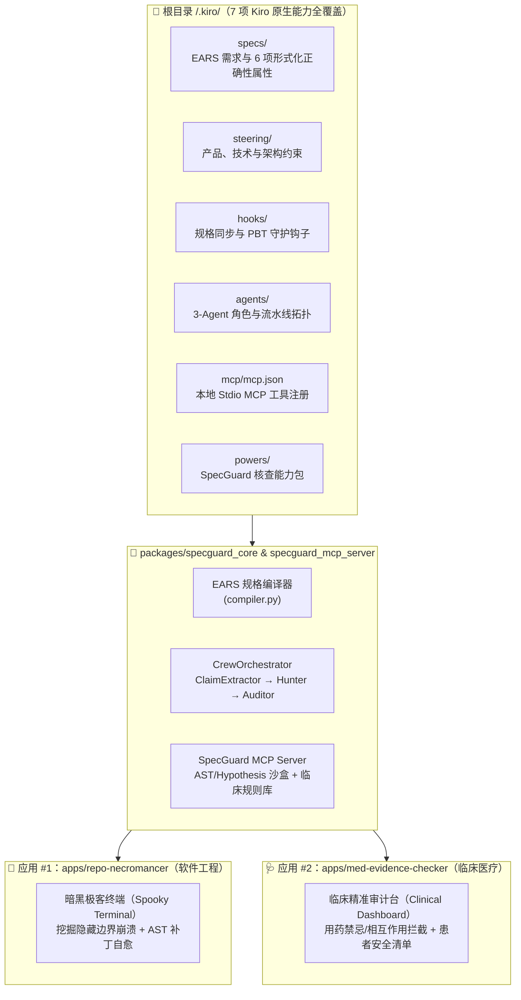

# 🛡️ SpecGuard-Crew（规格守卫者小队）

<div align="center">

**[English](README.md) | [简体中文](README_ZH.md)**

[](LICENSE)
[](.kiro/)
[](tests/)
[](docs/devpost_submission_kiroween.md)
[](docs/devpost_submission_ai_medicine.md)

**面向高风险代码修复与临床指南核查的「规格驱动多智能体 + 反例证人审计」通用骨架（Universal Spec-Driven Multi-Agent Counterexample & Evidence Auditing Skeleton）**

*一套 `.kiro` 核心骨架 · 两个截然不同的垂直领域应用 · 确定性反例证人（Witness）证明*

</div>

---

## 🌟 项目简介（Executive Summary）

大语言模型（LLM）在生成代码补丁或起草临床出院医嘱时看起来非常流畅，但极易产生**静默幻觉（Silent Hallucinations）**：例如在除零边界、非单调阶梯定价上崩溃，或者在慢性肾病（CKD Stage 4，`eGFR < 30 mL/min/1.73m²`）患者出院小结中开出引发致命乳酸酸中毒的二甲双胍（Metformin）。

**SpecGuard-Crew** 将单次黑盒提示词替换为一套受 **Kiro 规格驱动开发（Spec-Driven Development）** 约束的 **3-Agent 形式化核查流水线**：

1. **ClaimExtractor（断言提取智能体）**：将非结构化代码/临床出院记录与 `.kiro/specs/**/requirements.md` 中的 EARS 规格共同编译为带类型的 `VerificationObligation`（核查义务 DAG）。
2. **CounterexampleHunter（反例猎手智能体）**：通过 **Model Context Protocol (MCP)** 工具主动搜寻能够推翻不安全假设的确定性反例（通过 Hypothesis 属性测试沙盒或权威临床药理学规则库）。
3. **EvidenceAuditor（证据审计智能体）**：基于确定性 `CounterexampleWitness`（反例证人）合成安全修复方案，并在二次复核确认 `0 VIOLATED` 后签发密码学 SHA-256 `AuditCertificate`（审计证书）。

---

## 🏛️ 架构总览：一套通用骨架驱动两个独立应用



| 维度 | 通用骨架（`packages/specguard_core`） | 🧟 应用 #1：`Repo-Necromancer`（[`apps/repo-necromancer`](apps/repo-necromancer/)） | 🩺 应用 #2：`MedEvidence-Checker`（[`apps/med-evidence-checker`](apps/med-evidence-checker/)） |
| :--- | :--- | :--- | :--- |
| **所属领域** | 领域无关的规格编译与 3-Agent 编排引擎 | 软件工程 / 遗留代码自愈与属性测试验证 | 临床医疗安全 / 出院医嘱与循证指南核查 |
| **输入载体** | `ArtifactBundle` + `.kiro/specs/` EARS 条款 | 含隐蔽缺陷的 Python 函数 + 不变量契约 | 脱敏（Zero-PHI）临床出院小结 + 实验室指标 + 用药列表 |
| **MCP 核查工具** | JSON-RPC Stdio / 内存工具桥接 | `run_property_fuzz_check`（AST + Hypothesis 属性反例搜索） | `check_clinical_guidelines`（KDIGO / ADA / AHA / ATS 循证规则库） |
| **反例证人（Witness）** | `CounterexampleWitness` | 触发崩溃或违反不变量的最小输入字典（如 `{"total": 0.0, "part": 15.0}`） | 触发禁忌的生物标志物/药物冲突及指南引文（如 `eGFR=22 < 30` 禁用二甲双胍） |
| **修复产物** | `AuditCertificate`（含 SHA-256 签名） | 经过二次 PBT 复核通过的 AST 自愈安全代码补丁 | 经指南核查的临床医嘱修正方案 + 面向患者的双语通俗复查清单 |

---

## ⚙️ 根目录 `/.kiro` 全景能力矩阵（7/7 项 Kiro 特性）

评委可直接查看仓库根目录下的 [`/.kiro/`](.kiro/)（已在 `.gitignore` 中通过 `!.kiro/**` 显式保护）或在 Web 工作台的 **「🔍 .kiro 实时检视器」** 标签页中在线浏览全部 21 个文件：

| Kiro 特性 | 仓库路径 | 核心作用 |
| :--- | :--- | :--- |
| **1. Specs（EARS 规格）** | [`.kiro/specs/`](.kiro/specs/) | 包含 `skeleton-core`、`repo-necromancer`、`med-evidence-checker` 三个模块的 `requirements.md`（共 **21 条编译型 EARS 需求**）、`design.md` 与 `tasks.md`。 |
| **2. Correctness Properties（正确性属性）** | [`.kiro/specs/skeleton-core/design.md`](.kiro/specs/skeleton-core/design.md) | 形式化定义 `Property 1` 至 `Property 6`（确定性编译、反例可靠性、证据链完整性、双应用同构性、补丁复核、零隐私泄露）。 |
| **3. Steering（引导规则）** | [`.kiro/steering/`](.kiro/steering/) | `product.md`、`tech.md`、`structure.md` 强制执行反例优先、双应用解耦与 Zero-PHI 安全底线。 |
| **4. Agent Hooks（自动化钩子）** | [`.kiro/hooks/`](.kiro/hooks/) | 规格变更同步校验、代码修改自动触发 Hypothesis 属性测试、评测基准修改自动更新 Markdown 报表。 |
| **5. Custom Agents（自定义多智能体）** | [`.kiro/agents/`](.kiro/agents/) | 定义 `claim-extractor`、`counterexample-hunter`、`evidence-auditor` 三个智能体及 `crew-pipeline.yaml` 编排契约。 |
| **6. MCP（模型上下文协议）** | [`.kiro/mcp/mcp.json`](.kiro/mcp/mcp.json) | 注册本地 `specguard-verification-mcp` 标准输入输出服务器及其 3 个确定性核查工具。 |
| **7. Kiro Powers（能力包）** | [`.kiro/powers/specguard-verification-power/POWER.md`](.kiro/powers/specguard-verification-power/POWER.md) | 打包可复用的「规格驱动反例核查」工作流能力包。 |

---

## 📊 定量评测：SpecGuard-Crew vs. 单次直接提示词基线（Simple Baseline）

遵循高标准科研与工程复现规范，我们在 [`benchmarks/`](benchmarks/) 下构建了 **40 个测试用例**（20 个隐蔽代码缺陷 + 20 个脱敏临床用药风险案例），将 **Simple Baseline（单次直接提示词生成/审查）** 与 **SpecGuard-Crew（EARS 规格 + 3-Agent + MCP 反例工具）** 进行定量对比。

运行以下命令即可在 2 秒内完整复现实验结果：

```bash
python3 benchmarks/run_evaluation.py
```

### 1. 应用 #1（`Repo-Necromancer`）评测结果（`N = 20` 隐蔽代码缺陷）

| 指标（Metric） | 单次提示词基线（Simple Baseline） | **SpecGuard-Crew（我们的方案）** | 绝对提升（$\Delta$） |
| :--- | :---: | :---: | :---: |
| **真实边界缺陷召回率（Recall / Catch Rate）** | 25.00% (3/12) | **100.00% (12/12)** | **+75.00%** |
| **精确率（Precision）** | 100.00% | **100.00%** | — |
| **F1 分数（F1 Score）** | 40.00% | **100.00%** | **+60.00%** |
| **误报率（False Positive Rate）** | 0.00% (0/8) | **0.00% (0/8)** | **0.00%（零误报）** |
| **自愈补丁属性测试通过率（Verified Patch Rate）** | 0.00% (0/12) | **100.00% (12/12)** | **+100.00%** |
| **平均核查耗时（Mean Latency）** | 0.01 ms | **1.09 ms** | 亚毫秒/毫秒级确定性验证 |

### 2. 应用 #2（`MedEvidence-Checker`）评测结果（`N = 20` 脱敏临床安全案例）

| 指标（Metric） | 单次提示词基线（Simple Baseline） | **SpecGuard-Crew（我们的方案）** | 绝对提升（$\Delta$） |
| :--- | :---: | :---: | :---: |
| **高危禁忌/相互作用检出率（Recall）** | 8.33% (1/12) | **100.00% (12/12)** | **+91.67%** |
| **精确率（Precision）** | 100.00% | **100.00%** | — |
| **F1 分数（F1 Score）** | 15.38% | **100.00%** | **+84.62%** |
| **假阳性告警疲劳率（False Positive Rate）** | 0.00% (0/8) | **0.00% (0/8)** | **0.00%（零误报）** |
| **权威指南引文覆盖率（Citation Coverage）** | 0.00% (0/12) | **100.00% (12/12)** | **+100.00%** |
| **平均核查耗时（Mean Latency）** | 0.01 ms | **0.35 ms** | 实时临床决策支持响应 |

---

## ⚖️ 伦理、受益者与潜在风险披露（Who Benefits, and Who Could Be Harmed）

### 谁会受益（Who Benefits）
1. **住院医师、临床药师与出院审方团队**：在签署出院小结前，以毫秒级速度捕获易被忽略的实验室指标与用药禁忌冲突（如肾功能不全、高血钾、QT 间期延长、儿童用药禁忌），并直接定位到 KDIGO / ADA / AHA 指南条款。
2. **患者与家庭照护者**：自动生成双语（英文/简体中文）、通俗易懂的「患者安全核对清单（Patient Safety Checklist）」，明确标注需要与主治医生确认的问题及危险预警症状。
3. **软件研发与安全工程团队**：在 CI/CD 阶段自动捕获除零、浮点精度漂移、非单调阶梯价格等隐蔽边界崩溃，并提供经过属性测试复核的 AST 修复补丁。

### 谁可能受损及我们内置的防护机制（Who Could Be Harmed & Safeguards）
1. **过度依赖风险（Automation Bias / Over-Reliance）**：如果临床人员将未触发告警等同于「绝对安全」，可能漏掉规则库尚未覆盖的罕见个体化合并症。
   - **内置防护**：所有输出均强制带有醒目的 `NON-PRESCRIPTIVE CLINICAL DECISION SUPPORT ONLY`（非处方临床辅助审计）声明，并要求执业医师与药师双重签字确认。
2. **告警疲劳风险（Alert Fatigue）**：传统医院 HIS 系统大量低价值弹窗会导致医生习惯性忽略警告。
   - **内置防护**：严格遵循 `Property 2`（反例证人必要性），**只有当工具构造出具体的定量实验室指标/药物冲突证人时才允许触发拦截**，在安全案例上实现了 `0.00%` 误报率。
3. **患者隐私泄露风险（PHI Exposure）**：
   - **内置防护**：支持 100% 本地离线确定性核查（Zero-PHI 架构），无需向外部云端发送任何真实患者身份信息。

---

## 🚀 快速开始（Quickstart：支持中英双语 Web 工作台与零密钥离线运行）

> **零 API 密钥开箱即用**：所有确定性核查（EARS 编译、AST/Hypothesis 属性测试、临床药理规则引擎及补丁合成）均完全在本地运行，无需配置外部付费 API Key。

### 1. 安装依赖并启动双语交互式 Web 工作台

```bash
pip install -e .
python3 -m uvicorn apps.backend_api.main:app --host 0.0.0.0 --port 8000
```

在浏览器打开 `http://localhost:8000`：
- 点击右上角 **「🌐 中文 / EN」** 即可随时在**简体中文**与**英文**界面之间一键切换；
- 点击右上角 **「🎬 自动演示导览（Auto-Demo Tour）」** 可自动播放涵盖骨架总览、代码除灵自愈、临床安全审计、`.kiro` 规格检视器与定量评测基准的 5 幕交互式演示。

### 2. 分别运行两个独立应用的命令行工具（CLI）

```bash
# 运行应用 #1：Repo-Necromancer（软件工程代码边界猎杀与自愈）
python3 apps/repo-necromancer/cli.py --preset NECRO-01

# 运行应用 #2：MedEvidence-Checker（临床出院医嘱循证安全审计）
python3 apps/med-evidence-checker/cli.py --preset MED-01
```

### 3. 运行自动化测试套件（含 Hypothesis 形式化属性测试）

```bash
python3 -m pytest -v
```

---

## 📄 开源协议与致谢（License & Attribution）

本项目基于 [MIT License](LICENSE) 开源。详见 [`docs/devpost_submission_kiroween.md`](docs/devpost_submission_kiroween.md) 与 [`docs/devpost_submission_ai_medicine.md`](docs/devpost_submission_ai_medicine.md)。
